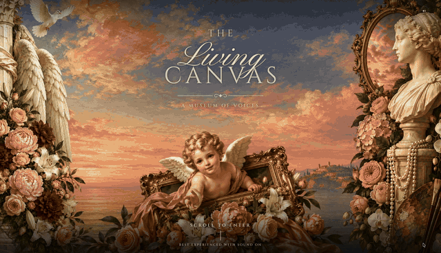
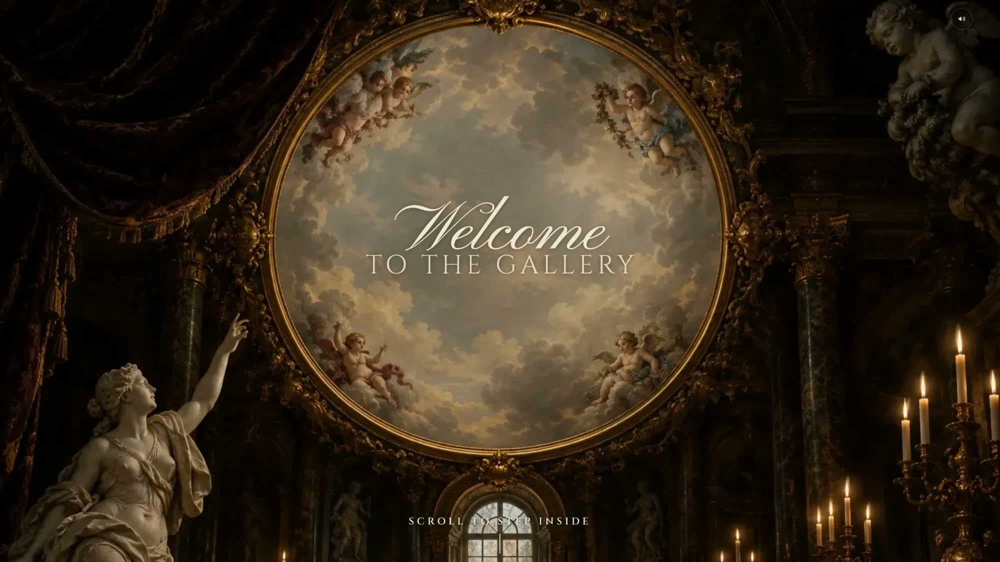
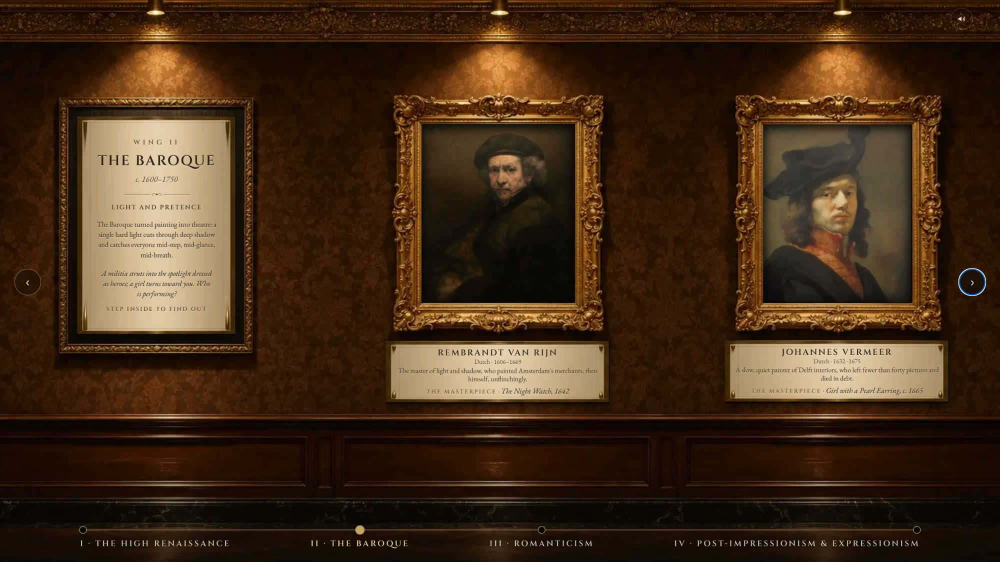
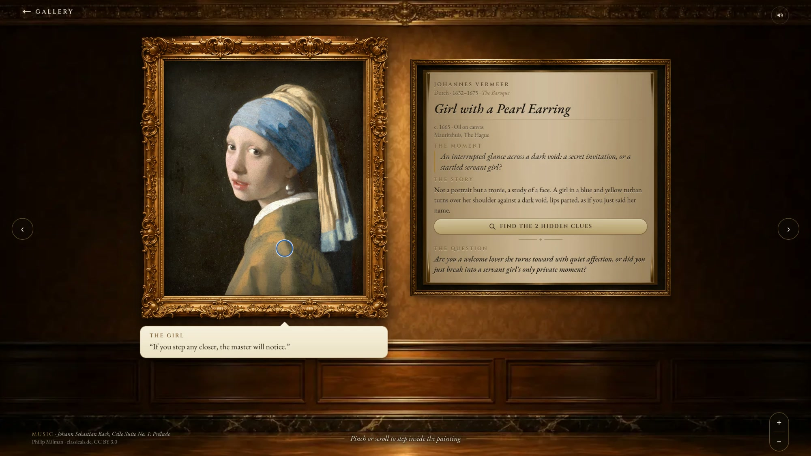
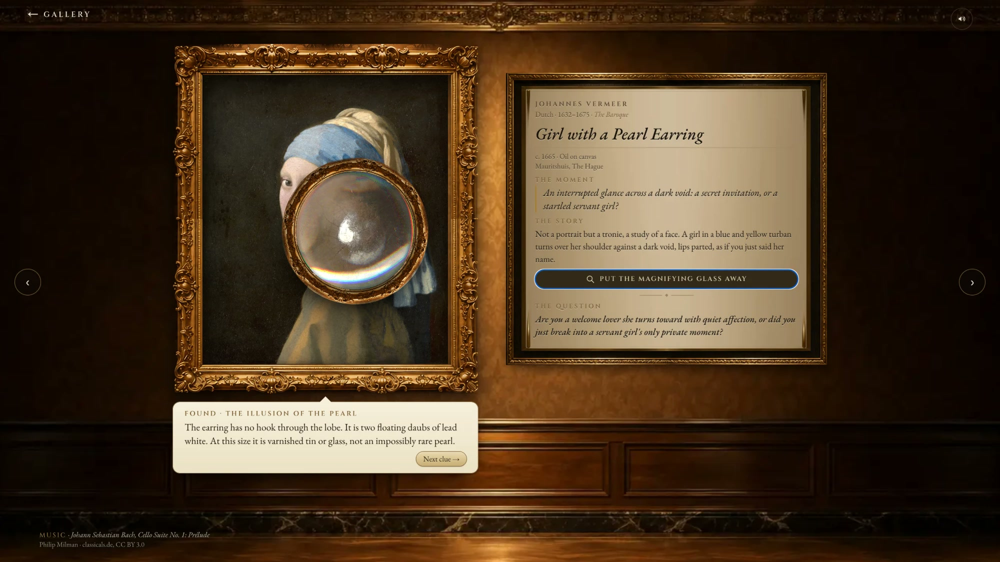

# The Living Canvas

**A museum of voices.** What if museum masterpieces were not silent relics on a wall, but living crime scenes, confessions, and psychological thrillers frozen in oil?

**Live demo:** [the-living-canvas-museum.vercel.app](https://the-living-canvas-museum.vercel.app) · best experienced on a laptop or desktop, with sound on.



*The walkthrough above plays at double speed. [Watch the full video with sound](docs/demo.mp4).*

| | |
| --- | --- |
|  |  |
|  |  |

## About

The Living Canvas is an immersive digital exhibition spanning four monumental eras of art history: **The High Renaissance, The Baroque, Romanticism, and Post-Impressionism & Expressionism**. Moving beyond passive museum plaques, it reimagines eight iconic canvases, from Leonardo da Vinci's *The Last Supper* to Edvard Munch's *The Scream*, as multi-sensory encounters where visual inspection, voice acting and period music converge into one cohesive narrative experience.

- **Forensic loupe discovery.** A magnifying glass lets visitors inspect high-resolution masterpieces for overlooked micro-clues, such as Judas's spilled salt cellar, Vermeer's faux-pearl lighting trick, the brain hidden in Michelangelo's billowing cloak, or the skull behind Munch's screaming face.
- **Character-driven audio theatre.** Dual-perspective, first-person monologues (the Hook, then the Disruptor) bring silent figures to life, exposing suppressed rivalries, mortal confessions and the human cost captured beneath the paint. Each character speaks in their own native accent.
- **Period soundscapes and a dynamic score.** Every room is paired with a historically and emotionally resonant piece, from Renaissance laments and driving Baroque strings to turbulent Romantic symphonies, with an ambient hush in the gallery. Built on the Web Audio API, the score dips beneath the spoken dialogue and swells back, so the voices stay clear without ever breaking the atmosphere.
- **Scholarly consensus and unresolved dilemmas.** Each exhibit pairs accepted art history with an open moral question, leaving visitors to decide whether Judas was a traitor or a predestined scapegoat, whether Adam hesitates to accept consciousness, and who truly pays for revolutionary liberty.

### The exhibition

| Wing | Painting | Speakers |
| --- | --- | --- |
| I · The High Renaissance | Leonardo da Vinci, *The Last Supper* | Judas Iscariot, Saint Peter |
| | Michelangelo, *The Creation of Adam* | The Divine Voice, Adam |
| II · The Baroque | Rembrandt, *The Night Watch* | Captain Frans Banninck Cocq, The Golden Girl |
| | Johannes Vermeer, *Girl with a Pearl Earring* | The Girl, Johannes Vermeer |
| III · Romanticism | Francisco Goya, *Saturn Devouring His Son* | Saturn, The Slain Son |
| | Eugène Delacroix, *Liberty Leading the People* | Marianne (Liberty), Gavroche |
| IV · Post-Impressionism & Expressionism | Vincent van Gogh, *The Starry Night* | Vincent van Gogh, The Cypress Tree |
| | Edvard Munch, *The Scream* | The Agonized Figure, The Passing Friend |

## Getting started

You need [Node.js](https://nodejs.org) 20.9 or later (22 recommended) and npm.

```bash
git clone https://github.com/Afifanasir/the-living-canvas.git
cd the-living-canvas
npm install
npm run dev
```

Then open [http://localhost:3000](http://localhost:3000) in your browser. Click once anywhere, or on the sound button, to let the browser play sound.

To build and run the production version:

```bash
npm run build
npm start
```

All the paintings, voices and music are included in `public/`, so nothing else is needed to run the exhibition.

## How it works

- **Framework:** [Next.js](https://nextjs.org) 16 (App Router) with React 19, [Tailwind CSS](https://tailwindcss.com) 4 and [Motion](https://motion.dev) (formerly Framer Motion) for animation.
- **Living paintings:** each painting has a depth map made with [Depth Anything V2](https://github.com/DepthAnything/Depth-Anything-V2). A WebGL shader shifts every pixel by its depth as the visitor moves, so the canvas gains real parallax depth (`components/Painting.tsx`).
- **The magnifying glass:** a WebGL lens with glass refraction, a carved gilt rim and clue detection that adapts its magnification to each clue (`components/Loupe.tsx`).
- **Sound:** a single Web Audio graph mixes room music, the gallery ambience and the voices, with crossfades between rooms, ducking under dialogue and a shared hall reverb (`lib/audio.ts`). Subtitles are timed word by word from each recording with an offline speech model (`scripts/cue-times.py` → `lib/cue-times.json`).
- **The walk:** scroll-driven, one gesture per step, with an eased glide that follows the trackpad (`app/page.tsx`, `components/WingWalk.tsx`).
- **Content:** every painting, character, monologue and clue lives in one file, `content/gallery.ts`.

The `scripts/` folder holds the tools used to prepare assets: depth maps, frame cut-outs, music loops, voice recording with ElevenLabs and subtitle timing. They need source files and API keys that are not part of this repository, and are not required to run the site.

## Credits

**Concept, curation, writing and design:** Afifa Nasir.

**Paintings:** reproductions of public-domain works, via Wikimedia Commons.

**Voices:** performed with [ElevenLabs](https://elevenlabs.io) voices from its library and voice design.

**Gallery ambience:** Moby, *LA1*, from *Long Ambients*, released into the public domain.

**Room music:**

| Painting | Piece | Performers |
| --- | --- | --- |
| *The Last Supper* | Josquin des Prez, *Mille regretz* | Ensemble Clément Janequin |
| *The Creation of Adam* | Giovanni Pierluigi da Palestrina, *Missa Papae Marcelli*: Kyrie | |
| *The Night Watch* | Antonio Vivaldi, Concerto Grosso in D minor, Op. 3 No. 11 | Orchestra of the Vienna State Opera |
| *Girl with a Pearl Earring* | Johann Sebastian Bach, Cello Suite No. 1: Prélude | Philip Milman, classicals.de (CC BY 3.0) |
| *Saturn Devouring His Son* | Ludwig van Beethoven, String Quartet No. 14, Op. 131 | Budapest String Quartet |
| *Liberty Leading the People* | Ludwig van Beethoven, Symphony No. 5: Allegro con brio | Ernest Ansermet, Orchestre de la Suisse Romande |
| *The Starry Night* | Claude Debussy, *Nocturnes*: Nuages | Jun Märkl, Orchestre National de Lyon |
| *The Scream* | Gustav Mahler, Symphony No. 5: Trauermarsch | Erich Leinsdorf, Boston Symphony Orchestra |

## Licence

The source code is released under the [MIT Licence](LICENSE).

The licence covers the code only. The painting reproductions are public domain; the music recordings remain the property of their respective rights holders and are credited above; the voices, room artwork and written content are © Afifa Nasir.
